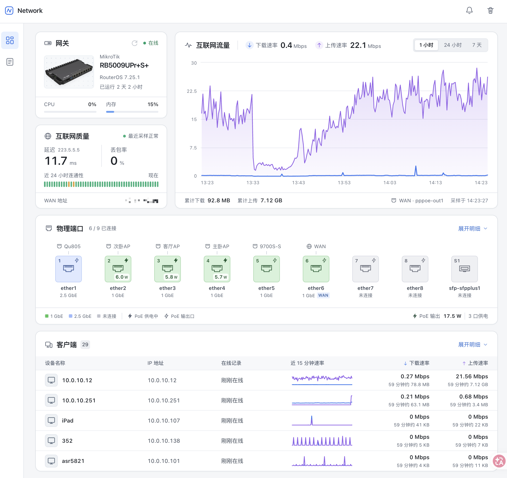

# Network · RB5009

[中文](README.md) · **English**

A lightweight dashboard for MikroTik RB5009 gateways. View gateway health, internet traffic, physical ports, PoE power and clients in one interface. The frontend and Python collector run in one Docker container; SQLite stores history.

[Offline image downloads](https://github.com/haoranxu1989/network-rb5009/releases/latest) · [GitHub Container Registry](https://github.com/haoranxu1989/network-rb5009/pkgs/container/network-rb5009) · [Detailed collection notes, Chinese](数据采集与功能实现.md)



## Scope and validation

| Gateway | Validation status |
| --- | --- |
| **RB5009UPr+S+IN** | Used on real hardware with RouterOS 7.25.1 and native API port 8728, including PoE output power. |
| **RB5009UG+S+IN** | The other intended model. Model artwork and operation without PoE-out are implemented; independent hardware validation is pending. Feedback is welcome. |
| Other models | Untested and outside the current support scope. |

Prebuilt images target **Linux amd64 (Intel / AMD x86_64)** and have been used on QNAP. Run the container on a NAS or Docker host and connect to the RB5009 over the network. This is not router firmware or a container intended to run inside RouterOS. No prebuilt ARM64 image is offered yet.

Documentation is available in Chinese and English. **The application UI is currently Chinese.** This is an independent community project, not affiliated with MikroTik or Ubiquiti.

## Features

- Gateway model, RouterOS version, uptime, CPU and memory.
- Download / upload rates and byte totals, with 1-hour, 24-hour and 7-day views.
- Gateway-originated latency and packet-loss probes, plus a 24-hour connectivity strip.
- Nine physical ports with link state, negotiated speed, comments, rates and totals; PoE output power on UPr.
- Client presence records, 15-minute sparklines and a 1-hour detail chart with a cursor.
- RouterOS logs and optional update download, RouterBOOT upgrade and manual reboot actions.

Collection starts with the container and continues while the browser is closed. The page refreshes automatically; gzip and incremental history updates reduce repeated transfers.

## 1. Prepare RouterOS

In WinBox → **IP → Services**, enable `api` (8728) or `api-ssl` (8729). Restrict **Available From** to the collector's actual source address, for example `192.168.88.20/32`. The input firewall must also allow that source and port.

- Standard Docker bridge networking normally uses the Docker host's LAN address. A QNAP container with its own LAN IP uses that container address.
- A dedicated account such as `network-reader` is recommended. Collection requires `read,api,test`; `test` is used for quality probes. Upgrades and reboot require additional RouterOS permissions; a read-only account cannot perform them.
- `api` is a **plaintext native protocol** for a trusted LAN or VPN. `api-ssl` uses TLS and needs a server certificate and trusted CA. Neither is the HTTP / HTTPS WebFig service. [RouterOS API documentation](https://help.mikrotik.com/docs/spaces/ROS/pages/47579160/API)

Port labels come from the RouterOS interface **Comment** field. Setting the comment on `ether1` to `NAS` updates the label after the next interface sample.

## 2. Deploy from GitHub Container Registry

```sh
git clone https://github.com/haoranxu1989/network-rb5009.git
cd network-rb5009
cp .env.example .env
chmod 600 .env
```

Edit `.env` with your gateway, RouterOS account and password, and a separate dashboard password. This example uses the native API on a trusted LAN:

```dotenv
ROUTEROS_HOST=192.168.88.1
ROUTEROS_TRANSPORT=api
ROUTEROS_PORT=8728
ROUTEROS_USER=network-reader
ROUTEROS_PASSWORD=replace-with-routeros-password
NETWORK_ADMIN_PASSWORD=replace-with-a-separate-dashboard-password
NETWORK_WEB_PORT=8080
```

```sh
docker compose up -d
```

Open `http://YOUR_DOCKER_HOST_LAN_IP:8080/`. The dashboard username is **`network`**; its password is `NETWORK_ADMIN_PASSWORD`. Standard Compose requires a dashboard password and stores history in the `network-data` volume.

Alternatively:

```sh
docker run -d --name network --restart unless-stopped \
  -p 8080:8080 --env-file .env \
  -v network-data:/data \
  ghcr.io/haoranxu1989/network-rb5009:2026.11.23
```

`NETWORK_WEB_PORT` controls the Compose host mapping only. With `docker run`, change the left-hand port in `-p` directly.

## 3. Offline import / QNAP

Download `network-rb5009-2026.11.23-linux-amd64.tar` and `SHA256SUMS` from [Releases](https://github.com/haoranxu1989/network-rb5009/releases/latest). The tar uses the traditional Docker archive format for direct import.

Verify with `sha256sum -c SHA256SUMS` on Linux or `shasum -a 256 -c SHA256SUMS` on macOS.

```sh
docker load -i network-rb5009-2026.11.23-linux-amd64.tar
```

The imported tag is `ghcr.io/haoranxu1989/network-rb5009:2026.11.23`, matching the Compose templates. Start offline with `docker compose up -d --pull never`.

**QNAP Container Station:**

1. Import the tar under Images. Leave “Import and create a container” unchecked initially.
2. Create an application using [qnap/compose.yaml](qnap/compose.yaml). It is based on a working QNAP deployment with an independent LAN IP.
3. Replace the gateway address, container IP, credentials and `qnet-static-eth0-20cf19` network name. `password` is a placeholder; reserve an unused IP for the container.
4. Mount `/share/Container/network/data` at `/data`. Visit the container IP on port **80**; an independent LAN IP needs no host `ports` mapping.

Uncomment and set `NETWORK_ADMIN_PASSWORD` to enable dashboard login as `network`. Without it, use a trusted LAN only: visitors can read the dashboard and reset its history, while router-maintenance actions are disabled.

The entrypoint prepares SQLite permissions, then runs the service as a non-root user. No root-only workaround command is needed. Reuse the same data directory when replacing the container. [QNAP guide](https://www.qnap.com/en-us/how-to/tutorial/article/how-to-use-container-station-3)

## Configuration

| Environment variable | Purpose |
| --- | --- |
| `ROUTEROS_HOST` | Gateway IP or hostname. Set explicitly. |
| `ROUTEROS_USER` / `ROUTEROS_PASSWORD` | RouterOS credentials, used only by the backend. |
| `ROUTEROS_TRANSPORT` | `api` or `api-ssl`; the program defaults to `api-ssl`, examples use LAN `api`. |
| `ROUTEROS_PORT` | Optional: defaults to 8728 for `api`, 8729 for `api-ssl`. |
| `NETWORK_ADMIN_PASSWORD` | Dashboard password for username `network`. |
| `NETWORK_HTTP_PORT` | Container HTTP port: 8080 by default, 80 in the QNAP template. |
| `NETWORK_WAN` | Optional WAN override, e.g. `pppoe-out1`; otherwise auto-detected. |
| `NETWORK_PING_TARGET` | ICMP target IP, default `223.5.5.5`. Choose a suitable regional target. |
| `ROUTEROS_CA_FILE` | Container path to a public CA certificate for API-SSL. |
| `ROUTEROS_SERVER_NAME` | Optional DNS name used for TLS verification. |

For API-SSL, mount your CA certificate read-only, e.g. at `/certs/router-ca.crt`, and set `ROUTEROS_CA_FILE`. The server certificate needs a matching IP SAN or the DNS name specified in `ROUTEROS_SERVER_NAME`. The program does not silently downgrade or disable certificate verification.

## Collection and limitations

| Data | Backend cadence | Storage |
| --- | --- | --- |
| CPU, memory, uptime, port state / negotiated speed, PoE power | 3 seconds | Latest values |
| WAN and interface counters | 5 seconds | Counter deltas produce rates; WAN charts cover up to 7 days |
| IPv4 clients and connection tracking | 10 seconds | Persisted presence evidence and rate samples |
| Internet quality | 60 seconds | 3 ICMP packets, 300 ms apart; 24-hour history |
| Gateway identity, addresses and default routes | 30 seconds | WAN selection and physical-port mapping |
| Known version status / update check | 10 seconds / 12 hours | Update checks depend on RouterOS permissions |
| RouterOS logs | About 10 seconds while the logs page is open | Router buffer only, not SQLite |

The overview waits 3 seconds after each request completes; logs wait 5 seconds. All browsers share one backend collector.

**Client rates and byte totals are estimates**, based on visible IPv4 connection-tracking counters. Short-lived connections, FastTrack, hardware offloading, purely switched traffic and IPv6 may be incomplete or absent. Do not use them for billing. Ordinary LAN clients show last-seen evidence when a connection start cannot be confirmed; PPPoE sessions with known uptime can show connection duration. Reloading does not restart these records.

The quality card reports **the latest round's mean RTT and packet loss from the gateway to the target IP**, not from your browser or NAS, and not a score for the entire internet. The connectivity strip covers 24 hours. See the [implementation notes, Chinese](数据采集与功能实现.md) for calculations and retention.

## Maintenance and troubleshooting

- HTTP Basic authentication does not encrypt transport. Use a trusted LAN / VPN or HTTPS reverse proxy, not direct public exposure.
- RouterOS downloads its own update. **Reboot is a separate, confirmed action**. RouterBOOT upgrades do not reboot automatically either.
- Resetting history clears dashboard records and baselines, not RouterOS configuration or device counters.
- Use `docker logs network` for connection errors. At `/healthz`, `status: ok` means the web service is running; `router` separately reports `connecting`, `online` or `offline`.
- Check address / port, Services, Available From, input firewall and permissions for API failures. WebFig ports 80 / 443 are not native API ports.

Before upgrading, stop the old container and back up `/data`. Pull or import the new image, update the Compose version, and reuse the data mount. Do not run `docker compose down -v` unless you intend to delete the named data volume.

## Development and license

`web/` is the TypeScript frontend. `network/` is the Python 3.13 backend, using Waitress and standard-library SQLite. Frontend builds use Node.js 22.

```sh
(cd web && npm ci && npm run check && npm test && npm run build)
python3 -m unittest discover -s tests -v
docker build -t network-rb5009:local .
```

Tests use synthetic data and simulated RouterOS replies. Open `index.html` for a demo; demo data does not mean your gateway is connected.

Project code is released under [MIT](LICENSE). Third-party code and MikroTik photo notices are in [NOTICES.md](NOTICES.md); MIT does not override third-party rights.
