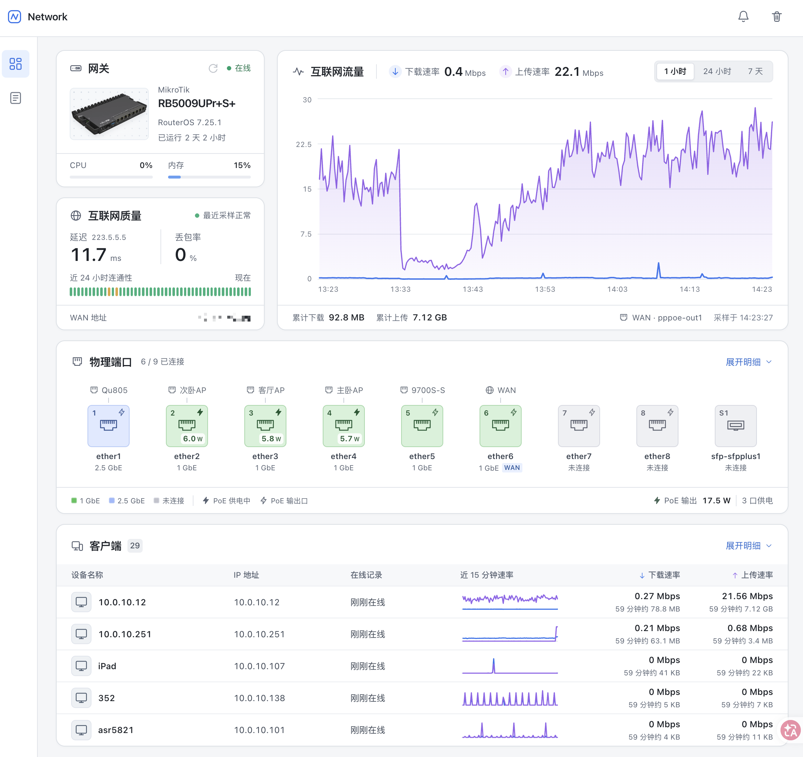

# Network · RB5009

**中文** · [English](README.en.md)

一个为 MikroTik RB5009 系列制作的轻量网络面板。用直观的首页查看网关状态、互联网流量、端口、PoE 和客户端。前端与 Python 后台在同一个 Docker 镜像中运行，SQLite 保存历史。

[下载离线镜像](https://github.com/haoranxu1989/network-rb5009/releases/latest) · [GitHub Container Registry](https://github.com/haoranxu1989/network-rb5009/pkgs/container/network-rb5009) · [数据来源与采集频率](数据采集与功能实现.md)



## 适用范围

| 网关型号 | 验证情况 |
| --- | --- |
| **RB5009UPr+S+IN** | 已实机使用：RouterOS 7.25.1、原生 API 8728，包含 PoE 输出功率。 |
| **RB5009UG+S+IN** | 另一款目标机型；已有对应展示及无 PoE-out 的处理，尚待独立实机验证与反馈。 |
| 其他型号 | 未测试，不在当前支持范围内。 |

发布镜像为 **Linux amd64（Intel / AMD x86_64）**，在 QNAP 上验证。容器运行在 NAS 或其他 Docker 主机上，通过网络连接 RB5009；这不是刷入路由器的固件，也不是运行在 RouterOS 内部的容器。暂不提供 ARM64 预构建镜像。

项目说明提供中英文，**当前界面为中文**。本项目是独立社区项目，与 MikroTik、Ubiquiti 无隶属关系。

## 功能

- 网关型号、RouterOS 版本、运行时间、CPU 和内存。
- 互联网下载 / 上传速率及累计流量，支持 1 小时、24 小时、7 天视图。
- 由网关发起的延迟、丢包探测，以及最近 24 小时连通性。
- 九个物理端口的连接状态、协商速率、接口备注、收发速率与累计；UPr 显示 PoE 输出功率。
- 客户端在线记录、15 分钟速率波形，以及详情中的 1 小时曲线和光标读数。
- RouterOS 日志，可选的下载更新、RouterBOOT 升级和手动重启。

后台随容器启动持续采集，关闭网页也会记录。页面自动更新，使用 gzip 与历史增量同步减少重复传输。

## 1. 准备 RouterOS

在 WinBox → **IP → Services** 启用 `api`（8728）或 `api-ssl`（8729）。在 **Available From** 填入采集端实际来源地址，例如 `192.168.88.20/32`，并确保 input 防火墙允许该来源访问对应端口。

- 普通 Docker 桥接网络通常使用 Docker 主机的 LAN 地址；QNAP 独立 IP 网络使用容器的 LAN 地址。
- 建议创建专用账号，如 `network-reader`，采集需要 `read,api,test` 权限。`test` 用于质量探测；升级和重启需要另外的 RouterOS 权限，只读账号无法执行。
- `api` 是**明文原生协议**，用于可信内网或 VPN；`api-ssl` 使用 TLS，需要配置服务证书和受信任 CA。它们不是 WebFig 的 HTTP / HTTPS 服务。[RouterOS API 文档](https://help.mikrotik.com/docs/spaces/ROS/pages/47579160/API)

端口上方的设备名称来自 RouterOS 接口的 **Comment**。例如给 `ether1` 的 Comment 填 `NAS`，下一次接口采样后即可显示。

## 2. GitHub Container Registry 部署

```sh
git clone https://github.com/haoranxu1989/network-rb5009.git
cd network-rb5009
cp .env.example .env
chmod 600 .env
```

编辑 `.env`，填写实际网关、账号、密码和独立面板密码。示例使用已实测的可信内网原生 API：

```dotenv
ROUTEROS_HOST=192.168.88.1
ROUTEROS_TRANSPORT=api
ROUTEROS_PORT=8728
ROUTEROS_USER=network-reader
ROUTEROS_PASSWORD=填写网关账号密码
NETWORK_ADMIN_PASSWORD=填写独立面板密码
NETWORK_WEB_PORT=8080
```

```sh
docker compose up -d
```

访问 `http://Docker主机的局域网IP:8080/`，面板用户名为 **`network`**，密码为 `NETWORK_ADMIN_PASSWORD`。通用 Compose 要求设置面板密码，历史保存在 `network-data` 数据卷。

也可直接运行：

```sh
docker run -d --name network --restart unless-stopped \
  -p 8080:8080 --env-file .env \
  -v network-data:/data \
  ghcr.io/haoranxu1989/network-rb5009:2026.11.23
```

`NETWORK_WEB_PORT` 只用于 Compose 宿主机端口映射；`docker run` 请直接修改 `-p` 左侧端口。

## 3. 离线导入 / QNAP

从 [Releases](https://github.com/haoranxu1989/network-rb5009/releases/latest) 下载 `network-rb5009-2026.11.23-linux-amd64.tar` 和 `SHA256SUMS`。这是可直接导入的传统 Docker 镜像归档。

Linux 用 `sha256sum -c SHA256SUMS` 校验，macOS 用 `shasum -a 256 -c SHA256SUMS`。

```sh
docker load -i network-rb5009-2026.11.23-linux-amd64.tar
```

导入后的名称为 `ghcr.io/haoranxu1989/network-rb5009:2026.11.23`，可使用同一份 Compose。离线启动用 `docker compose up -d --pull never`。

**QNAP Container Station：**

1. 在「映像 → 导入」中选择 tar，先不要勾选「导入并创建容器」。
2. 新建应用程序，粘贴 [qnap/compose.yaml](qnap/compose.yaml)。模板基于实际 QNAP 部署，使用独立 LAN IP。
3. 替换示例中的网关地址、容器 IP、账号密码和 `qnet-static-eth0-20cf19` 网络名。`password` 只是占位符，容器地址必须是你预留的空闲 IP。
4. 挂载 `/share/Container/network/data` 到 `/data`。访问容器 IP 的 **80** 端口；独立 IP 模式不需要宿主机 `ports` 映射。

建议取消注释并填写 `NETWORK_ADMIN_PASSWORD`，启用面板登录，用户名为 `network`。不设置时，仅在可信内网使用；可访问面板的人也可清空面板历史，网关维护按钮禁用。

启动入口准备 SQLite 权限后，以非 root 的服务用户运行，无需添加以 root 运行的 `command`。更换容器时复用同一数据目录即可保留历史。[QNAP 操作指南](https://www.qnap.com/en-us/how-to/tutorial/article/how-to-use-container-station-3)

## 配置项

| 环境变量 | 含义 |
| --- | --- |
| `ROUTEROS_HOST` | 网关 IP 或主机名，请显式填写。 |
| `ROUTEROS_USER` / `ROUTEROS_PASSWORD` | RouterOS 账号密码，仅后台使用。 |
| `ROUTEROS_TRANSPORT` | `api` 或 `api-ssl`；程序默认 `api-ssl`，示例使用内网 `api`。 |
| `ROUTEROS_PORT` | 可留空；`api` 默认 8728，`api-ssl` 默认 8729。 |
| `NETWORK_ADMIN_PASSWORD` | 独立面板密码，用户名 `network`。 |
| `NETWORK_HTTP_PORT` | 容器内部 HTTP 端口，默认 8080；QNAP 模板为 80。 |
| `NETWORK_WAN` | 可选，指定 WAN 接口，如 `pppoe-out1`；默认自动识别。 |
| `NETWORK_PING_TARGET` | ICMP 目标 IP，默认 `223.5.5.5`，可按所在地区替换。 |
| `ROUTEROS_CA_FILE` | 自建 CA 的公开证书在容器内的路径。 |
| `ROUTEROS_SERVER_NAME` | 可选，TLS 验证所用的证书 DNS 名称。 |

API-SSL 请只读挂载 CA 证书，如 `/certs/router-ca.crt`，并设置 `ROUTEROS_CA_FILE`。证书需包含对应 IP SAN，或使用 `ROUTEROS_SERVER_NAME` 指定的 DNS 名称。程序不会自动降级到明文或跳过证书验证。

## 采集频率与边界

| 数据 | 后台频率 | 保存方式 |
| --- | --- | --- |
| CPU、内存、运行时间、端口状态 / 协商速率、PoE 功率 | 3 秒 | 最新值 |
| WAN 和接口字节计数 | 5 秒 | 差值计算速率，WAN 图表可看 7 天 |
| IPv4 客户端和连接跟踪 | 10 秒 | 后台保存在线证据和速率样本 |
| 互联网质量 | 60 秒 | 每轮 3 个 ICMP 包，间隔 300 ms，保存 24 小时 |
| 网关名称、地址和默认路由 | 30 秒 | 出口识别与端口映射 |
| 已知版本状态 / 检查新版本 | 10 秒 / 12 小时 | 检查权限取决于 RouterOS 账号 |
| RouterOS 日志 | 日志页打开期间约 10 秒 | 读设备缓冲区，不存 SQLite |

首页每次请求完成后等待 3 秒更新，日志页等待 5 秒。多个网页共用一个后台采集器。

**客户端速率与累计是估算值**，基于可见的 IPv4 连接跟踪计数。短连接、FastTrack、硬件卸载、纯二层交换和 IPv6 等流量可能缺失，不适合计费。普通 LAN 设备无法确认连接起点时显示「最近在线」；可确认 uptime 的 PPPoE 会话才显示连接时长。刷新网页不会重新计时。

质量卡片显示**网关到探测 IP 最近一轮的平均 RTT 和丢包率**，不是浏览器或 NAS 的延迟，也不是整个互联网的综合评分。连通性条覆盖 24 小时。详细计算和保留规则见 [功能实现文档](数据采集与功能实现.md)。

## 维护与排查

- HTTP Basic 登录不加密传输，请在可信内网 / VPN 中使用，或置于 HTTPS 反向代理后，不要直接暴露公网。
- 更新由 RouterOS 自己下载，下载就绪后需**单独确认重启**。RouterBOOT 升级也不会自动重启。
- 「重置数据」清除面板历史和累计基线，不会重置 RouterOS 配置或设备计数器。
- 用 `docker logs network` 排查连接；`/healthz` 的 `status: ok` 代表服务正常，`router` 另报 `connecting`、`online` 或 `offline`。
- API 连不上时检查：IP / 端口、Services、Available From、input 防火墙和账号权限。不要使用 WebFig 的 80 / 443。

升级时先停止旧容器并备份 `/data`，再拉取或导入新镜像，更新 Compose 版本并复用数据挂载。不要执行 `docker compose down -v`，它会删除命名数据卷。

## 开发与许可证

`web/` 是 TypeScript 前端，`network/` 是 Python 3.13 后台，使用 Waitress 与标准库 SQLite。前端构建使用 Node.js 22。

```sh
(cd web && npm ci && npm run check && npm test && npm run build)
python3 -m unittest discover -s tests -v
docker build -t network-rb5009:local .
```

测试使用合成数据与模拟 RouterOS 回复。`index.html` 可离线演示；演示不代表网关已连接。

项目代码采用 [MIT](LICENSE)。第三方代码和 MikroTik 产品照片说明见 [NOTICES.md](NOTICES.md)；MIT 不替代第三方素材的原有权利。
